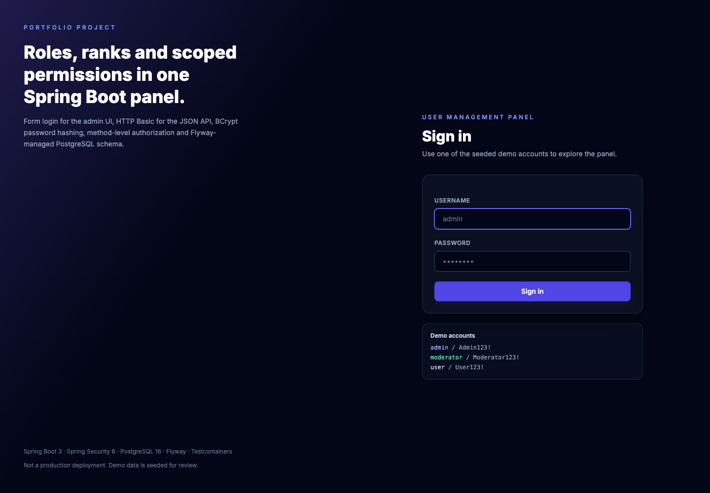
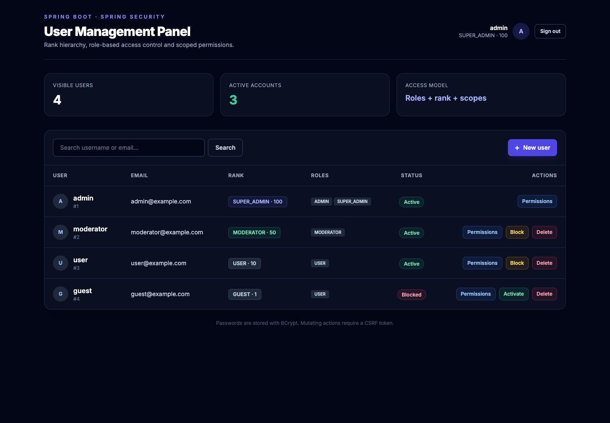
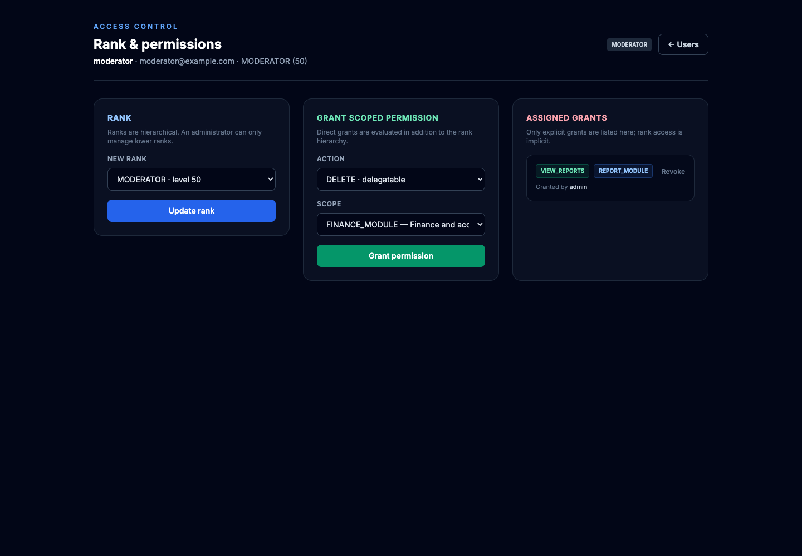
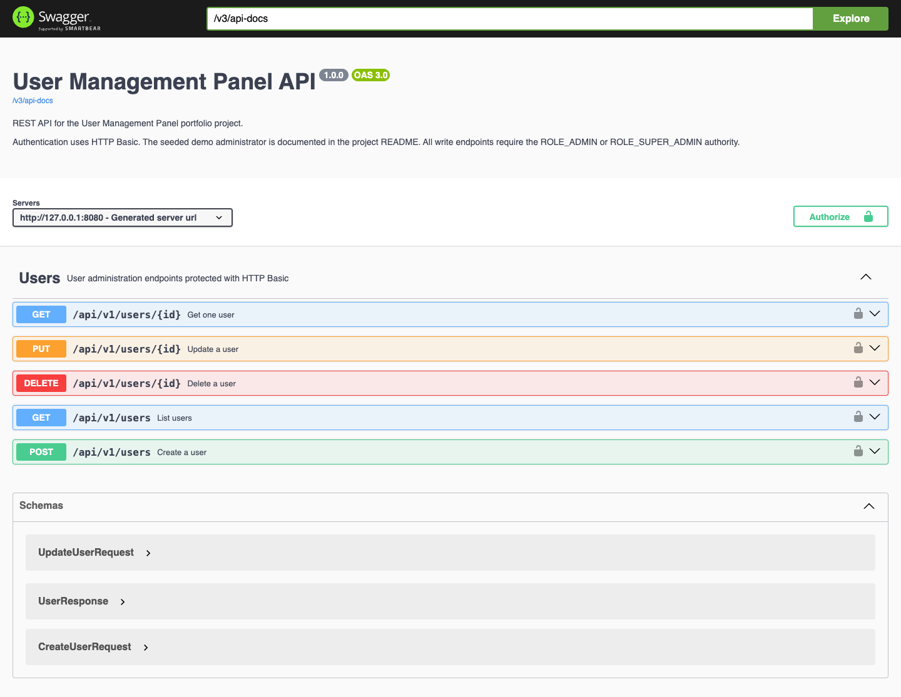
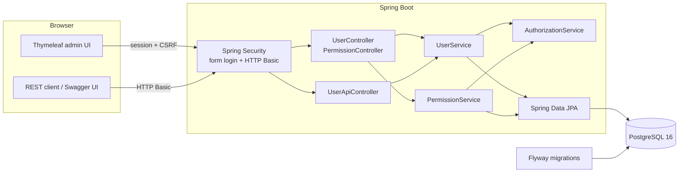

# User Management Panel

A Spring Boot admin panel that demonstrates layered authorization: Spring Security roles, a rank
hierarchy, and scoped, delegatable permissions on top of a PostgreSQL schema managed by Flyway.

The project started as a university assignment and was rebuilt as a portfolio piece. It is a
demonstration application, not a production SaaS product. No production-scale or load-testing claims
are made.

[](https://github.com/Cnek00/User-Management-Panel/actions/workflows/ci.yml)


## Screenshots

| Sign in | User administration |
| --- | --- |
|  |  |

| Rank and scoped permissions | OpenAPI documentation |
| --- | --- |
|  |  |

## What it demonstrates

- **Two authentication mechanisms** — form login for the Thymeleaf UI, HTTP Basic for the stateless
  JSON API. Passwords are BCrypt hashes; there are no plaintext credentials in the database.
- **Method-level authorization** — `@PreAuthorize` checks on controllers and services, backed by a
  custom `UserDetailsService` that maps both roles and rank to authorities.
- **A domain authorization layer** — ranks (100 → 1) decide who may manage whom, while direct
  permissions are scoped to modules and can be marked as delegatable.
- **Flyway-owned schema** — Hibernate runs in `validate` mode; every table and the demo data are
  created by versioned migrations.
- **Integration tests against real PostgreSQL** — Testcontainers starts PostgreSQL 16, runs Flyway,
  and exercises login, role restrictions, validation, and the REST API.
- **API documentation** — springdoc-openapi publishes the API contract and Swagger UI.

## Architecture



### Authorization model

Authorization is intentionally evaluated in three layers:

1. **Spring Security roles** gate entire areas of the application.
2. **Rank hierarchy** prevents privilege escalation and horizontal management of peers.
3. **Scoped permissions** grant an action (for example `VIEW_REPORTS`) on a module (for example
   `REPORT_MODULE`). A permission can be delegatable, which controls whether its holder may pass it on.

| Rank | Level | Intended use |
| --- | ---: | --- |
| `SUPER_ADMIN` | 100 | Full access, may assign any rank |
| `ADMIN` | 80 | Manage users below level 80 and grant scoped permissions |
| `MODERATOR` | 50 | Read-only access to user administration |
| `EDITOR` | 30 | Reserved for future content workflows |
| `USER` | 10 | Standard account, no admin access |
| `GUEST` | 1 | Disabled demo account |

| Spring Security role | UI access | API access |
| --- | --- | --- |
| `ROLE_SUPER_ADMIN` | Everything | Full CRUD |
| `ROLE_ADMIN` | User CRUD, rank and permission management | Full CRUD |
| `ROLE_MODERATOR` | User list and permission overview | Read-only |
| `ROLE_USER` | No admin pages | No admin endpoints |

Domain rules are enforced in addition to the role checks:

- an actor may only manage users with a strictly lower rank;
- an actor cannot change their own rank, block themselves, or delete themselves;
- an administrator cannot assign a rank at or above their own;
- permission grants require both a lower-ranked target and a delegatable permission;
- duplicate username/email and duplicate scope grants are rejected with `409 Conflict`.

## Demo accounts

The Flyway demo migration seeds four accounts. These credentials are for local review only.

| Username | Password | Rank | Roles |
| --- | --- | --- | --- |
| `admin` | `Admin123!` | `SUPER_ADMIN` | `ROLE_SUPER_ADMIN`, `ROLE_ADMIN` |
| `moderator` | `Moderator123!` | `MODERATOR` | `ROLE_MODERATOR` |
| `user` | `User123!` | `USER` | `ROLE_USER` |
| `guest` | `Guest123!` | `GUEST` | `ROLE_USER` (disabled) |

The moderator also receives one explicit `VIEW_REPORTS` grant on `REPORT_MODULE` to show how scoped
permissions appear in the UI.

## Tech stack

| Layer | Technology |
| --- | --- |
| Language | Java 17 |
| Framework | Spring Boot 3.3 (Web MVC, Data JPA, Validation, Security) |
| View layer | Thymeleaf + Tailwind CSS (CDN) |
| Database | PostgreSQL 16 |
| Migrations | Flyway |
| API docs | springdoc-openapi / Swagger UI |
| Testing | JUnit 5, Mockito, AssertJ, MockMvc, Testcontainers |
| Build | Maven Wrapper |
| Runtime | Docker, Docker Compose |
| CI | GitHub Actions |

## Project structure

```
.
├── backend
│   ├── .mvn/wrapper
│   ├── Dockerfile
│   ├── pom.xml
│   └── src
│       ├── main
│       │   ├── java/com/example/UserManagmentPanel
│       │   │   ├── api          # REST controller, DTOs, problem details
│       │   │   ├── config       # Security, OpenAPI
│       │   │   ├── controller   # Thymeleaf MVC controllers
│       │   │   ├── entity       # JPA entities
│       │   │   ├── exception    # Domain exceptions
│       │   │   ├── repository   # Spring Data repositories
│       │   │   ├── security     # UserDetailsService
│       │   │   └── service      # Business rules and authorization
│       │   └── resources
│       │       ├── db/migration # Flyway SQL
│       │       └── templates    # Thymeleaf views
│       └── test                 # Unit + Testcontainers integration tests
├── docs/screenshots
├── .github/workflows/ci.yml
├── docker-compose.yml
└── .env.example
```

## Running with Docker

Prerequisites: Docker Desktop (or another Docker engine) and Docker Compose.

```bash
cp .env.example .env
# Set a strong DB_PASSWORD in .env before starting.
docker compose up -d --build
```

The UI is available at <http://localhost:8080>. Swagger UI is at
<http://localhost:8080/swagger-ui.html>.

PostgreSQL is exposed on the port from `DB_PORT` (default `5434`). The application container runs
Flyway on startup and waits for the database health check.

To stop the stack:

```bash
docker compose down
```

To remove the demo database as well:

```bash
docker compose down -v
```

## Running locally

Prerequisites: Java 17+, a running PostgreSQL 16 instance, and the environment variables below.

```bash
cd backend
export SPRING_DATASOURCE_URL=jdbc:postgresql://localhost:5434/n_one_db
export SPRING_DATASOURCE_USERNAME=postgres
export SPRING_DATASOURCE_PASSWORD=your-password
./mvnw spring-boot:run
```

| Variable | Default | Purpose |
| --- | --- | --- |
| `SPRING_DATASOURCE_URL` | `jdbc:postgresql://localhost:5434/n_one_db` | JDBC URL |
| `SPRING_DATASOURCE_USERNAME` | `postgres` | Database user |
| `SPRING_DATASOURCE_PASSWORD` | — (required) | Database password |
| `SPRING_PORT` | `8080` | HTTP port |
| `SPRING_JPA_SHOW_SQL` | `false` | SQL logging |

Flyway runs automatically on startup. Hibernate does not create or update tables.

## REST API

The API uses HTTP Basic authentication and is stateless. That means no session cookie and no CSRF
token are involved; each request carries the credentials.

| Method | Path | Access | Description |
| --- | --- | --- | --- |
| `GET` | `/api/v1/users?q=` | moderator+ | List or search users |
| `GET` | `/api/v1/users/{id}` | moderator+ | Fetch one user |
| `POST` | `/api/v1/users` | admin+ | Create a user |
| `PUT` | `/api/v1/users/{id}` | admin+ | Update email, status, rank, roles or password |
| `DELETE` | `/api/v1/users/{id}` | admin+ | Delete a user |

Example:

```bash
curl -u admin:'Admin123!' \
  -H 'Content-Type: application/json' \
  -d '{"username":"jane","email":"jane@example.com","password":"Password123!","roles":["ROLE_USER"]}' \
  http://localhost:8080/api/v1/users
```

Responses never include password hashes. Validation and domain errors are returned as
`application/problem+json` with `400`, `403`, `404` or `409` status codes.

## Tests

```bash
cd backend
./mvnw verify
```

The suite contains 31 tests:

- **Unit tests** with JUnit 5 and Mockito for `UserService`, `PermissionService`,
  `AuthorizationService`, and `CustomUserDetailsService`.
- **Integration tests** with Testcontainers PostgreSQL 16, Flyway, MockMvc and Spring Security test
  support. They cover HTTP Basic, form login, role restrictions, payload validation, duplicate
  handling, and OpenAPI availability.

Testcontainers needs a reachable Docker daemon. On macOS with Docker Desktop, if the socket is not
auto-detected, export it before running the tests:

```bash
export DOCKER_HOST=unix://$HOME/.docker/run/docker.sock
```

## CI

`.github/workflows/ci.yml` runs on every push and pull request:

- builds the application with Java 17 and runs the full test suite (including Testcontainers);
- builds the production Docker image.

## Design notes and limitations

- The demo data is intentionally seeded by Flyway so the application is useful immediately after
  `docker compose up`. Replace or delete `V2__demo_data.sql` for a real deployment.
- The UI uses the Tailwind CDN to keep the project a single deployable Spring Boot artifact. A
  production build would compile Tailwind instead.
- There is no live deployment; the repository is set up to run locally with Docker Compose.
- The project is scoped as a portfolio demonstration. It does not claim production traffic,
  enterprise adoption, or a specific company size.
- The package name `UserManagmentPanel` keeps the original spelling to avoid a noisy rename; the
  product name is written correctly in the UI and documentation.

## Possible next steps

- Add password reset and email verification.
- Add audit logging for rank and permission changes.
- Replace CDN Tailwind with a compiled asset pipeline.
- Add pagination to the user list for larger datasets.
- Add a small Playwright smoke test on top of the MockMvc coverage.
